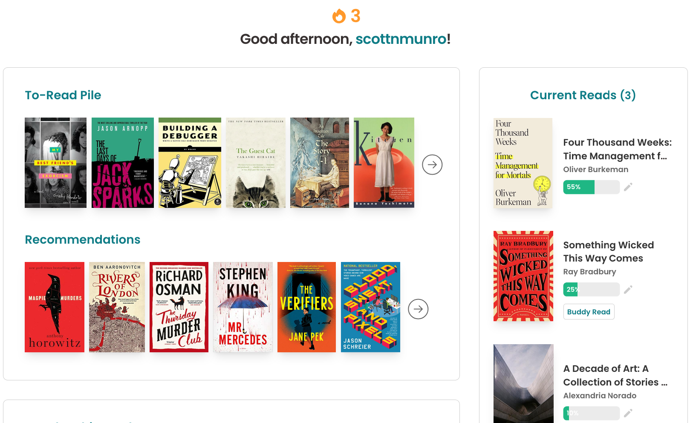
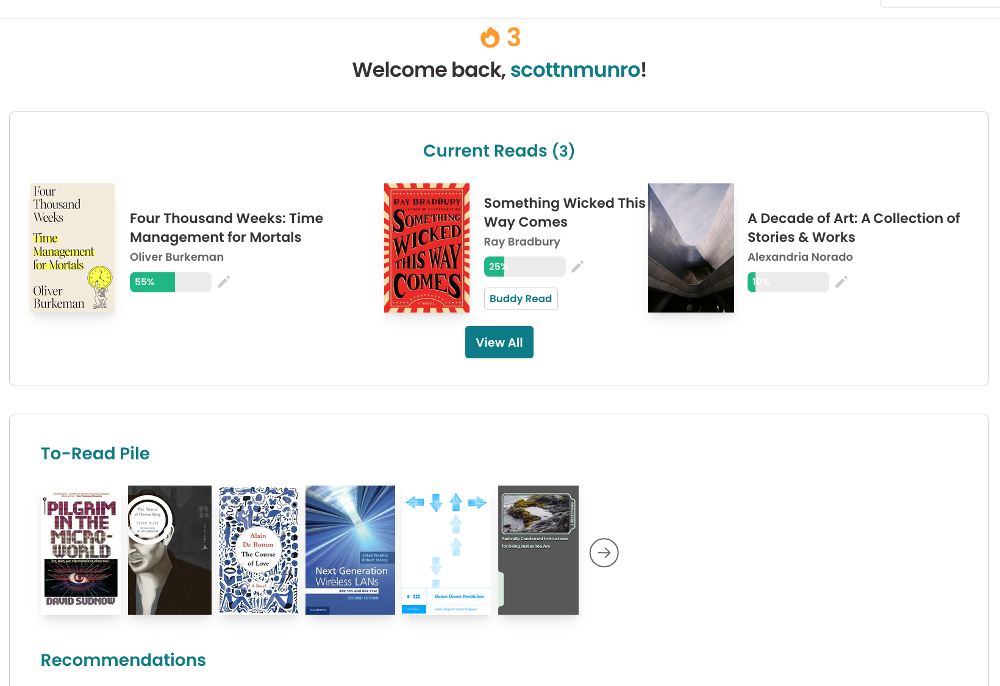

# ScottNM Storygraph View

Web extensions to customize the storygraph site view for my own personal preference.

Today, this mostly means moving the "Current Read(s)" section to the top of the page
and incidentally pushing down the less useful elements like "Recommendations", "Popular", and "Giveaways" which are mostly noise to me.

Intended for desktop only. 

The mobile site and storygraph app already render things fine by my preferences.

| | |
|-|-|
| before |  |
| after |  |